<p align="center">
  
</p>

<h1 align="center">ClusterNebula</h1>

<p align="center"><strong>A full-screen 3D clustering studio for reading CSV data as an interactive field.</strong></p>

<p align="center">
  
  
  
</p>

## Concept

ClusterNebula turns a plain CSV into a living 3D point field. Choose three numeric features, set the number of clusters, and inspect how local k-means groups the data directly in the browser.

## Highlights

- Full-screen Three.js scene with orbit controls and motion toggle.
- CSV paste, CSV file upload, and instant demo dataset.
- Local k-means clustering with no external API.
- Cluster centroids, connection traces, hover readouts, and quality metrics.
- Markdown report generation for quick documentation.
- Minimal creative-coding interface with a `more details / back` workbench.

## Run

```bash
npm install
npm run dev
```

Then open:

```text
http://127.0.0.1:5173
```

## Build

```bash
npm run build
```

## Design Note

The interface was rebuilt as an original minimalist WebGL direction for the portfolio. It does not include copied assets, text, or source code from external sites.
